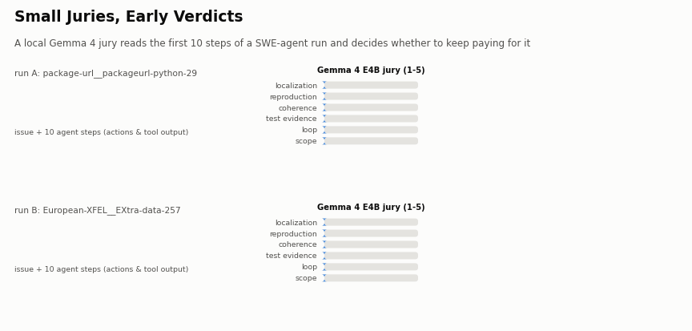
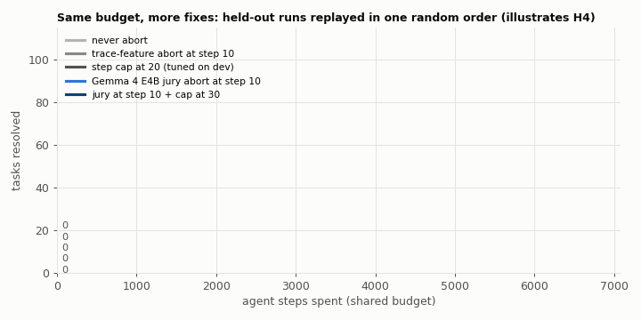
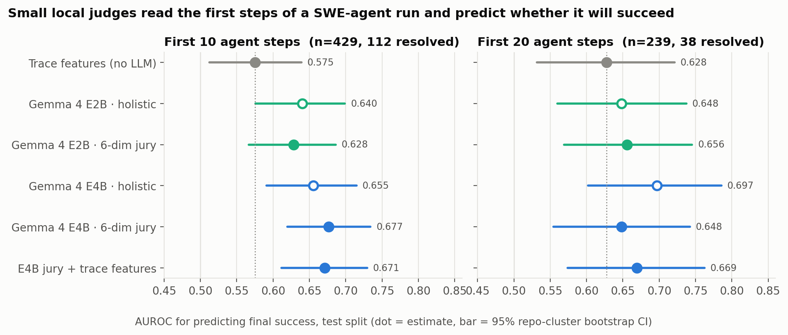
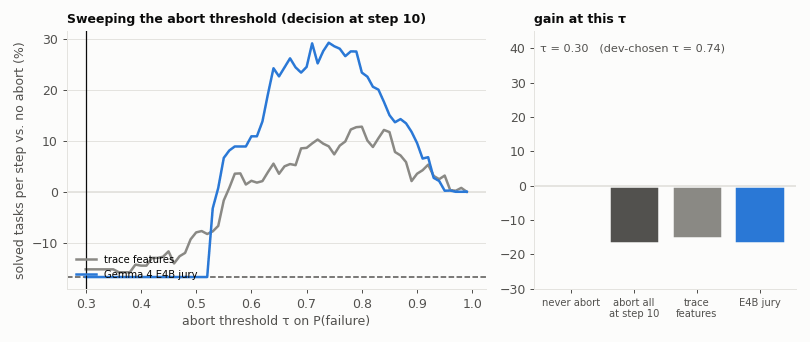
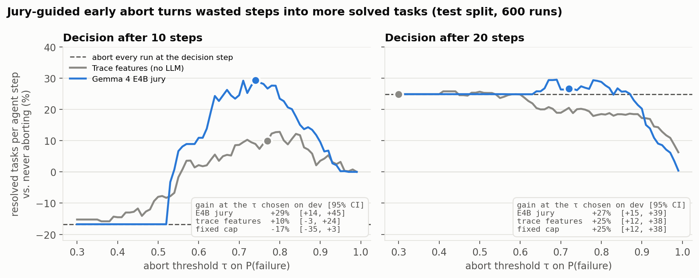
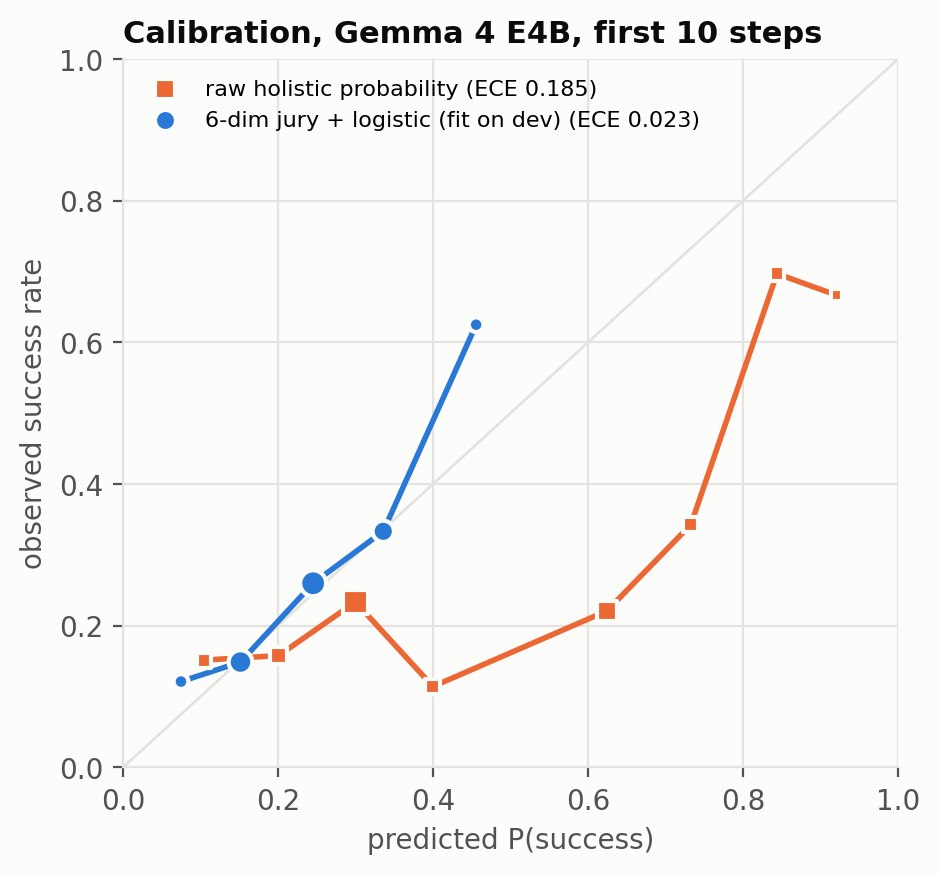
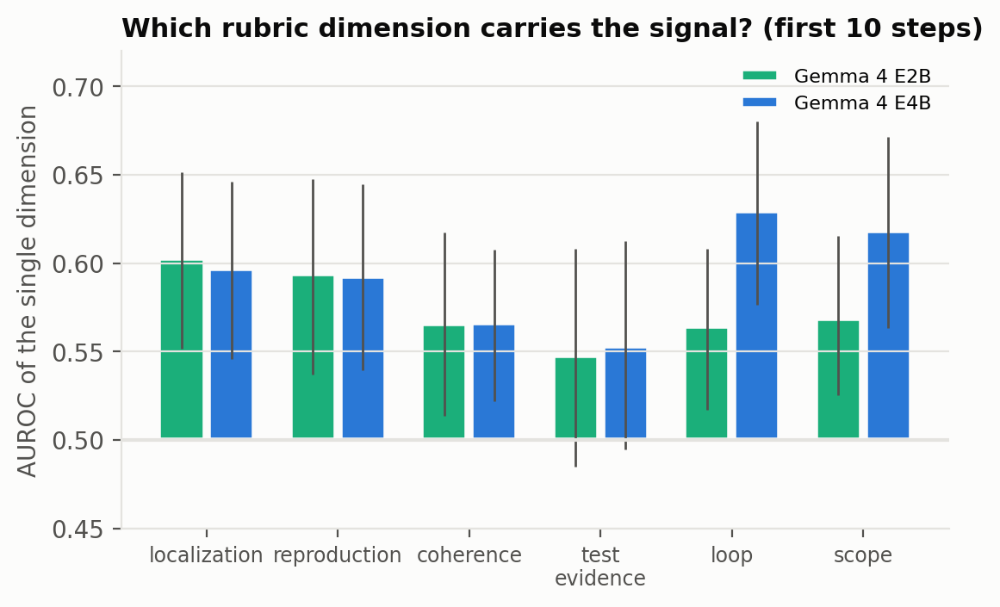
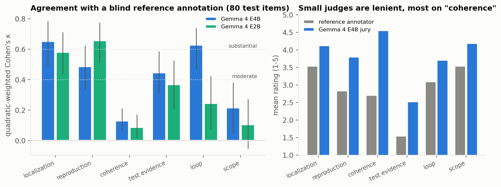
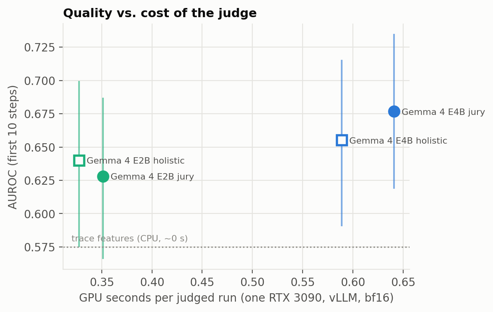

<div align="center">

# Small Juries, Early Verdicts

**A local Gemma 4 jury reads the first 10 steps of a coding-agent run, predicts whether it will fail,
and lets the same compute budget resolve 29% more GitHub issues.**

[](LICENSE)


Submission to the **Google – The Gemma 4 Developer Agent Paper Track** (Kaggle, 2026) ·
[Paper (Kaggle Writeup text)](paper/writeup.md) · [PDF](paper/small-juries-early-verdicts.pdf) ·
[Pre-registration](PREREGISTRATION.md) · [Experiment log](experiments/LOG.md)



</div>

## Why this matters

Offline coding agents on consumer hardware live under a hard budget, and **most of that budget is burned on attempts that
will fail** (83% of the 80,036 public SWE-agent runs we study are unresolved, and failing runs are the long ones). Running the
tests tells you whether an attempt worked only at the very end. This project asks a cheaper, earlier question:

> *After ten steps, is this run worth continuing?*

We answer it with a **small jury**: Gemma 4 E4B (or E2B) scores the partial log on six engineering dimensions, and a
7-parameter logistic layer turns the scores into a calibrated probability of success. No environment, no tests, no access
to the final patch — just the log so far.

## Results at a glance

| | First 10 steps | What it means |
|---|---|---|
| **AUROC, Gemma 4 E4B jury** | **0.677** [0.619, 0.734] | vs. **0.575** for 43 hand-built trace features (Δ +0.10, Holm p = 0.02) |
| **Signal is in the run** | issue only: 0.53 → +10 steps: 0.68 | reading the agent's first steps adds +0.14 AUROC [+0.07, +0.22] |
| **Calibration (ECE)** | **0.023** | raw "give me a probability" answers from the same model: 0.185 |
| **Early-abort policy** | **+29%** resolved tasks per agent step [+14, +45] | vs. never aborting (Holm p = 0.004) |
| vs. trace-feature policy | **+19 points** [+7, +33] | same policy, no LLM |
| **Jury at step 10 + step cap** | **+36%** [+19, +54] | composes with the best cap tuned on dev (cap alone: +25%) |
| **Gemma 4 E2B** | 93% of E4B's AUROC at 55% of the GPU time | 0.35 s per judgement on one RTX 3090 |
[[QWEN_README_ROW]]

All numbers are on **600 held-out runs from repositories never seen during development**, with 95% repository-cluster
bootstrap intervals (2,000 resamples) and Holm correction over the 8 confirmatory tests.

<div align="center">

<br><sub>Same step budget, held-out runs replayed in one random order: aborting the runs the jury distrusts frees budget for runs that succeed.</sub>
</div>

### Small judges see failure coming



At step 10 the E4B jury clearly beats the no-LLM control. At step 20 only 38 of the judged test runs were resolved, so every
interval is wide (the pre-registered k = 20 test is inconclusive). With *fractional* prefixes ("the first 66% of a run")
trace features look much stronger (AUROC 0.72) — but only because "66% of the run" leaks how long the run will be. A live
monitor never knows that, so **all headline results use absolute step prefixes**.

### Choosing the abort threshold

<div align="center">

</div>

The threshold τ is picked on development runs only; the curve above is the held-out test split. The jury curve dominates the
trace-feature curve across almost the whole range, and killing every run at step 10 is the worst option. A step cap tuned on
development runs (20 steps) is a strong baseline (+25%); the jury matches it while deciding ten steps earlier, and the two
combine to +36%. The gain survives charging one agent step per judgement (+23%), any threshold within ±0.10 of the chosen
one (+20% to +29%) and re-weighting to the dataset's base rate (+35%) — see `results/robustness.json`.



### Calibrated out of the box, and interpretable

<p>


</p>

The six dimensions are **localization, reproduction, coherence, test evidence, loop and scope**. "Loop" (is the agent stuck
repeating itself?) and "scope" carry most of the signal for E4B at step 10, which gives every verdict a readable reason.

### Does the jury measure what it says?



80 random test prompts were re-rated blind (no outcome, no Gemma scores) by four independent Claude Sonnet annotators using
the identical rubric. E4B agrees substantially on **localization (κw 0.65)** and **loop (0.63)**; the mean score correlates
at ρ = 0.73. Small judges are lenient, most on "coherence", which is where agreement is weakest.



## How it works

```
GitHub issue + first k agent steps  ──►  Gemma 4 jury (vLLM, T=0, JSON)  ──►  6 scores (1-5)
                                                                              │
                         abort if 1 − P(success) > τ   ◄──  P(success)  ◄──  logistic layer (fit on dev)
```

* **Data:** [`nebius/SWE-agent-trajectories`](https://huggingface.co/datasets/nebius/SWE-agent-trajectories) (CC-BY-4.0),
  one run per repository and outcome → 1,765 runs from 1,276 repositories; 60/40 repository-disjoint split; 600 test runs.
* **Prefixes:** issue + first k ∈ {10, 20} actions and observations; only runs longer than k are judged, so the ending is
  never visible. Patches, test logs and exit status are stripped (`src/04_checks.py` asserts it).
* **Judges:** `google/gemma-4-E4B-it`, `google/gemma-4-E2B-it` and the control `Qwen/Qwen3-4B-Instruct-2507`, all bf16 on
  vLLM 0.32.0, temperature 0, fixed seed, byte-identical prompts ([`prompts/`](prompts)).
* **Control without an LLM:** 43 prefix-only trace features with logistic regression / gradient boosting.
* **Policy:** abort at step k if predicted failure > τ; aborted runs cost k steps; τ chosen on development data.
* **Statistics:** AUROC, ECE, Brier; paired repository-cluster bootstrap (B = 2,000); Holm over 8 confirmatory contrasts.

## Reproduce

```bash
git clone https://github.com/Agnuxo1/small-juries-early-verdicts && cd small-juries-early-verdicts
python -m venv .venv && .venv/bin/pip install -r requirements-analysis.txt
python -m venv .venv-vllm && .venv-vllm/bin/pip install -r requirements-inference.txt
export SJEV_ROOT=$PWD/work            # data/, models/, out/ live here
bash scripts/reproduce.sh             # sample → features → splits → judges → analysis → figures
```

Every stage is a plain script in [`src/`](src); [`scripts/reproduce.sh`](scripts/reproduce.sh) lists them in order with the
exact arguments we used. A full rerun of the judges takes ≈ 2–3 GPU-hours per model on one RTX 3090. To regenerate only the
statistics and figures from the released verdicts, see [`results/`](results) and run `python scripts/make_figures.py`.

| Stage | Script | Compute |
|---|---|---|
| sample, strip leakage | `01_sample.py`, `04_checks.py` | CPU |
| trace features + baseline | `02_features.py`, `03_baseline.py` | CPU, minutes |
| repository-disjoint splits | `05_splits.py` | CPU |
| judges (holistic + jury) | `06_judge.py` | 1 GPU, vLLM |
| pre-registered analysis H1–H4 | `07_analysis.py` | CPU |
| p-values, Holm, H4 contrasts, control model | `08_supplementary.py` | CPU |
| blind validation set + agreement | `09_export_validation.py`, `10_validation.py` | CPU |
| figures and GIFs | `scripts/make_figures.py` | CPU |

## Repository layout

```
src/            experiment code (Apache-2.0)
prompts/        the exact judge prompts (version v1, frozen after the dev pilot)
results/        metrics, contrasts, per-run predictions and verdict scores, cost logs, validation
experiments/    LOG.md and experiments.csv: every run, including discarded and negative ones
figures/        paper figures (PNG) and README animations (GIF)
paper/          Kaggle Writeup text and PDF
validation/     blind reference annotations (ratings only)
```

## Released resource

`results/test_predictions.csv` and `results/verdicts/` contain, for every judged run, the run id, outcome, the six jury scores,
the holistic probability and every calibrated score, for E2B, E4B and the Qwen control. Trajectory text is **not**
redistributed: fetch it from the source dataset by `instance_id` (CC-BY-4.0; model outputs in that dataset are subject to
the Llama 3.1 license).

## Credits

* Francisco Angulo de Lafuente ([@Agnuxo1](https://github.com/Agnuxo1)) — study design, rubric (inspired by the multi-judge
  tribunals of [BenchClaw](https://github.com/Agnuxo1/benchclaw); conceptual inspiration only, no code reused).
* Engineering, analysis and writing assisted by Claude (Anthropic); routine design decisions logged with the JEV-Orchestrator
  decision engine.
* Data: Nebius `SWE-agent-trajectories` (CC-BY-4.0). Models: Google Gemma 4 (Apache-2.0), Qwen3 (Apache-2.0).
  Serving: vLLM. Statistics: scikit-learn, SciPy.

## Limitations

These are the normal boundaries of a two-day study, listed so the results can be used correctly:
trajectories come from one scaffold (SWE-agent) and Llama-3.1 drivers, so transfer to the Gemma 4 competition harness is
still to be measured; the H4 budget simulation assumes freed steps are reinvested at average efficiency; the k = 20 analysis
is under-powered (38 resolved runs); the rubric was validated against an LLM reference rather than human experts; and the
pre-registration was kept in time-stamped project notes rather than a public registry.

## Citation

```bibtex
@misc{angulo2026smalljuries,
  title  = {Small Juries, Early Verdicts: Calibrated Early Failure Prediction for Budgeted Offline SWE Agents},
  author = {Angulo de Lafuente, Francisco},
  year   = {2026},
  note   = {Gemma 4 Developer Agent Paper Track, Kaggle},
  url    = {https://github.com/Agnuxo1/small-juries-early-verdicts}
}
```

Released under the [Apache License 2.0](LICENSE).
